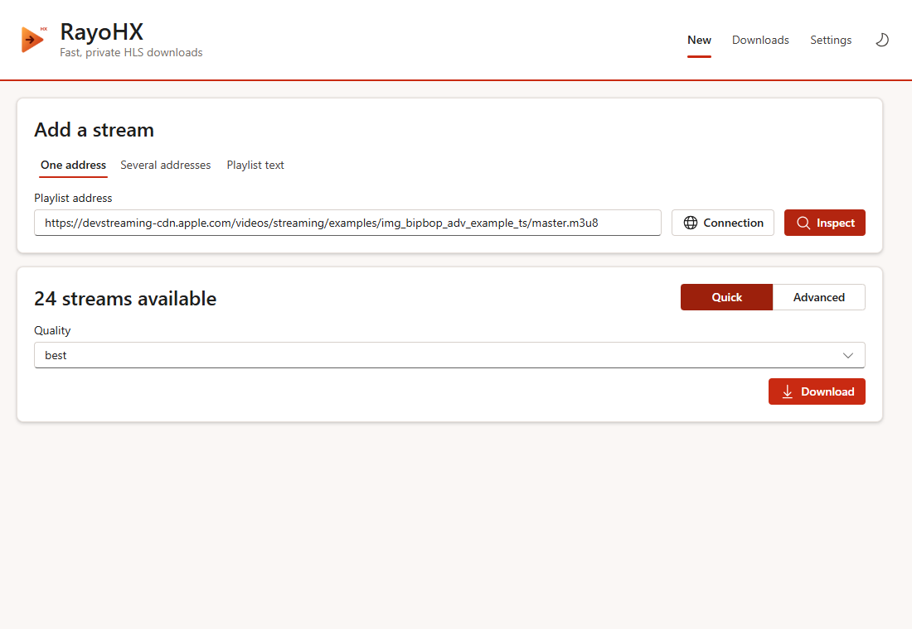

# RayoHX Desktop

[](https://github.com/coldsofttech/RayoHX-Desktop/actions/workflows/ci.yml)
[](https://github.com/coldsofttech/RayoHX-Desktop/actions/workflows/security.yml)
[](https://github.com/coldsofttech/RayoHX-Desktop/releases)
[](#install)
[](https://react.dev/)
[](https://github.com/astral-sh/ruff)
[](https://github.com/astral-sh/uv)
[](LICENSE)

Download HLS streams from a desktop window on Windows, without the terminal.

[Download the setup or the portable zip](https://github.com/coldsofttech/RayoHX-Desktop/releases),
then start RayoHX Desktop from the Start Menu (or run `rayohxd.exe` from the zip).



## What is RayoHX?

RayoHX is a tool for saving HLS streams (`.m3u8` links) as ordinary video files. Many websites play
video as a stream made of many small pieces, which is awkward to save by hand. Give RayoHX the
stream's web address and it looks at what the stream offers, lets you choose the quality, audio and
subtitles you want, and puts everything together into a single file you can keep and play anywhere.

RayoHX comes in several forms that share the same engine: a Python library, a command line, a
Docker image and this **desktop window for Windows**.

## How it helps

- **No terminal needed**: paste a stream's address into the window and see what it offers before
  you download anything
- **Get exactly what you want**: pick a quality with one click, or choose the exact stream, size,
  codec and the audio and subtitle tracks
- **Nothing else to run**: everything the window needs is built in and starts with it
- **Finish what you started**: your download folder and default options are remembered between runs,
  and a failed download can be retried or replaced with one button
- **Easy to follow**: downloads update live, each one has a log you can read, and there are light and
  dark themes

## What you can do

- Download one stream, several at once, or a playlist you paste in as text
- Use every download option RayoHX has: network, stream selection, storage, output and engine settings
- Save default options once and have them apply to every new download
- Choose where downloads are saved, and open that folder in Explorer from the window
- Use files from your computer, such as cookie files and certificates, with the usual system dialogs
- Clear finished downloads, and keep your list between restarts (a download cut short by closing the
  app shows as failed, so you can retry it)

## Install

### Windows setup

Download `rayohx-desktop-<version>-windows-x64-setup.exe` from the newest
[release](https://github.com/coldsofttech/RayoHX-Desktop/releases) and run it. It needs no Python and
works on Windows 10 or 11, which already include the Microsoft Edge WebView2 runtime the window uses.
It installs for you only by default, or for all users if you choose that (Windows asks for
permission). The app goes to `ColdSoft Technologies\RayoHX Desktop`, you can add a desktop shortcut,
and you start it from the Start Menu. Remove it from Windows Settings > Apps; your settings and
downloads list are kept unless you choose to remove them.

For a silent install, run `setup.exe /S`, with `/allusers`, `/DESKTOP` or `/D=C:\folder` if you want
them.

### Portable zip

Download `rayohx-desktop-<version>-windows-x64.zip` from the same release, extract it anywhere and run
`rayohxd\rayohxd.exe`. Nothing is installed and nothing is changed on your computer; delete the folder
to remove it.

Each release lists SHA-256 checksums in `SHA256SUMS.txt`, so you can check your download:

```sh
sha256sum --check SHA256SUMS.txt
```

## Open the window

```sh
rayohxd.exe             # open the window
rayohxd.exe --no-window # serve the interface for a browser instead of a window
rayohxd.exe --version   # show the installed version
rayohxd.exe --help
```

The [window guide](docs/guides/ui.md) walks through adding a stream, following downloads and the
settings.

## Other ways to use RayoHX

| What it is | Where |
|---|---|
| The `rayohx` command, installed with Python | [`rayohx-cli`](https://pypi.org/project/rayohx-cli/) |
| Python library, to use RayoHX inside your own programs | [`rayohx`](https://pypi.org/project/rayohx/) |
| The command as a container image | `ghcr.io/coldsofttech/rayohx` |

## Learn more

- [Window guide](docs/guides/ui.md): adding streams, downloads and settings
- [Security](docs/security.md): how the window and the API protect your data
- [Documentation index](docs/README.md): architecture, development, testing, releasing and packaging, and the internal API
- [Changelog](CHANGELOG.md)
- [Contributing](CONTRIBUTING.md) · [Security policy](SECURITY.md) · [Support](SUPPORT.md)
- [Report a problem](https://github.com/coldsofttech/RayoHX-Desktop/issues)

## License

Apache-2.0. See [LICENSE](LICENSE).
