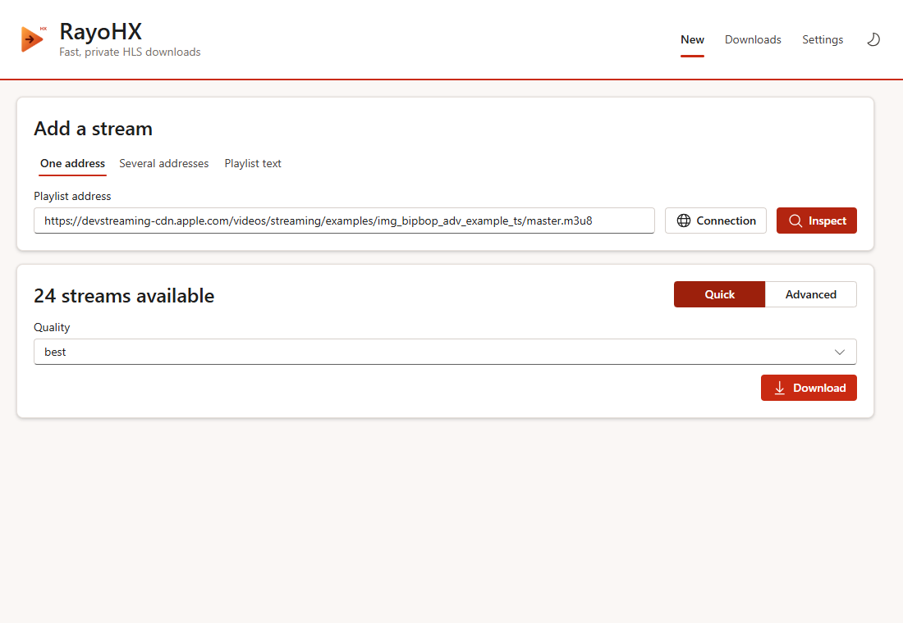

# Window guide

`rayohxd` is the RayoHX desktop window for Windows. It is a front end over the same engine as the
[command line](https://github.com/coldsofttech/RayoHX-CLI/blob/main/docs/guides/cli.md) and the [Python package](https://github.com/coldsofttech/RayoHX/blob/main/docs/guides/python.md):
the window only shows your choices and results, and all the work is done by the `rayohx` library.



## Install

The window is installed from two compiled wheels, `rayohx_desktop` and `rayohx_api`, which you download
from the newest [release](https://github.com/coldsofttech/RayoHX-Desktop/releases) and install together
with `pip install rayohx_api-*.whl rayohx_desktop-*.whl`. It needs Windows 10 or 11, the Microsoft Edge
WebView2 runtime (which both already include) and Python 3.15. It is not published on PyPI, and there is no
installer, so nothing is added to the Start Menu or the desktop.

Each release lists SHA-256 checksums in `SHA256SUMS.txt`. Check your download with
`sha256sum --check SHA256SUMS.txt` before installing, and install into a virtual environment or with `pipx`
so the window's dependencies stay apart from your other tools.

To upgrade, download the wheels of the newer release and run the same `pip install` command again with
`--upgrade`. Your saved defaults, download list and logs stay, because they are kept outside the install.

## Open the window

Start it from a terminal:

```text
rayohxd
rayohxd --no-window    # serve the interface for a browser instead of a window
rayohxd --version
```

## The screens

The bar at the top has three pages and a theme switch. The sun and moon button changes between the light
and dark themes, and your choice is remembered.

| Page | What it is for | Guide |
|---|---|---|
| **New** | Add one stream, several, or pasted playlist text; pick a quality or the exact stream | [Add a stream](ui/add-a-stream.md) |
| **Downloads** | Follow, pause, stop and retry downloads, and read what the engine reported | [Downloads](ui/downloads.md) |
| **Settings** | Download folder, default options, clean-up and version | [Settings](ui/settings.md) |

## Keeping secrets safe

Logins and passwords you type for a download are used for that download only. They are never saved with
the default options. Fields for passwords and other secrets are hidden while you type, and the page
shows addresses, errors and logs as plain text. The protections that exist today are in
[security](../security.md#under-the-desktop-window).

## Troubleshooting

- **The window does not open.** The window needs the Microsoft Edge WebView2 runtime. Run
  `cornea doctor` to check for it, or start `rayohxd --no-window` and open the address it prints in a
  browser to see whether the interface itself works.
- **The wheel will not install.** The wheels are built for Windows and Python 3.15 only. Install
  `rayohx_api` and `rayohx_desktop` together from the same release, as in [Install](#install).
- **A download failed.** Open its log from the card on the [Downloads](ui/downloads.md) page to see what
  the engine reported, and retry it from there.
- **Window logs.** The window's own log is kept in `%LOCALAPPDATA%\Cornea\logs\cornea.log`.
