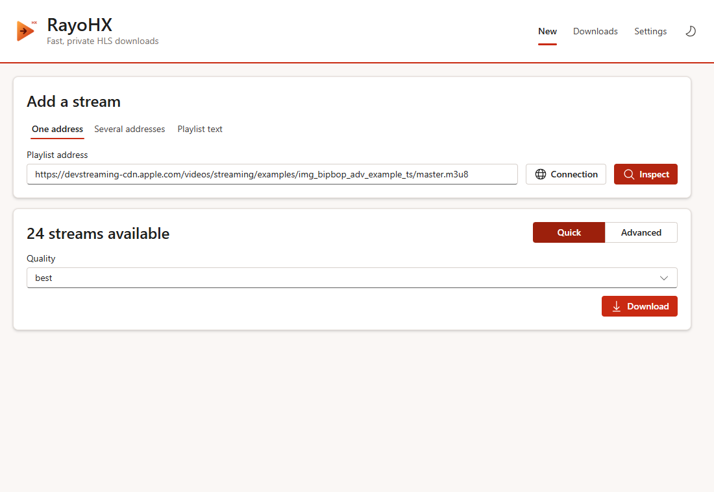
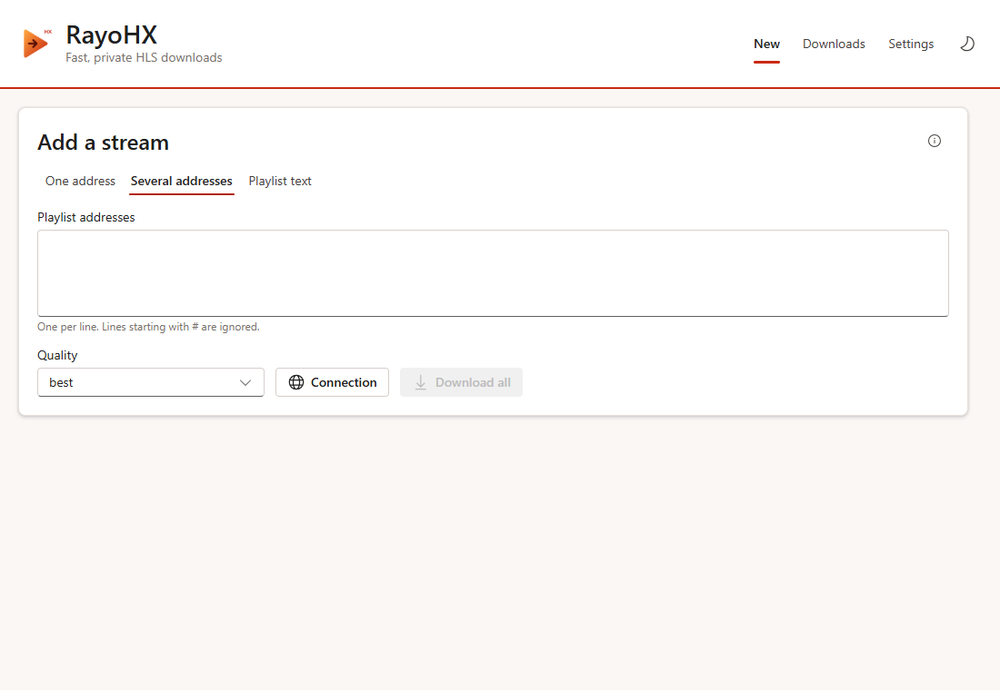
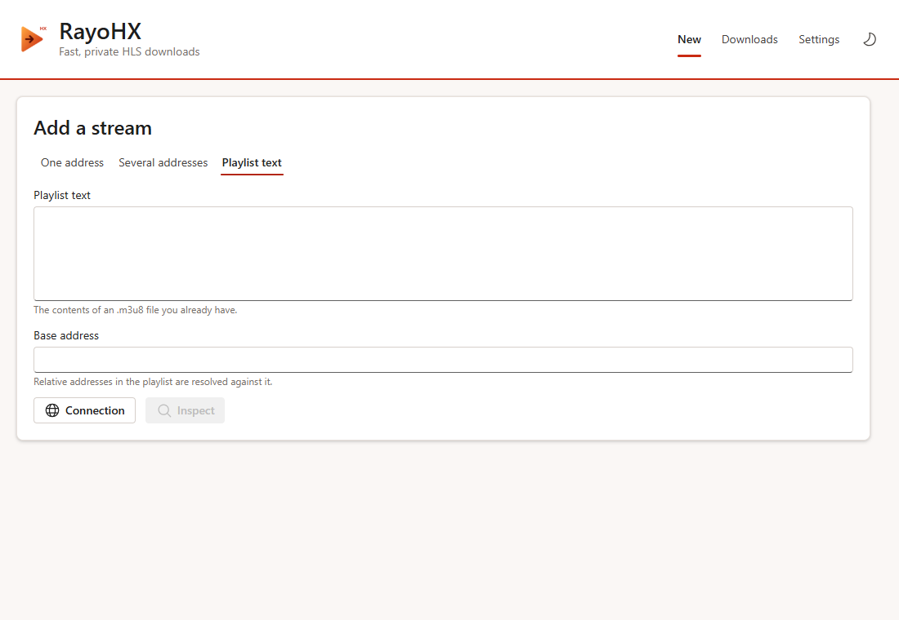
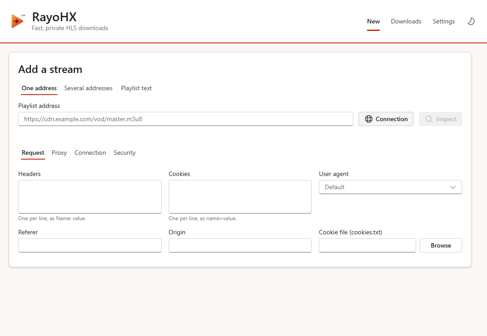
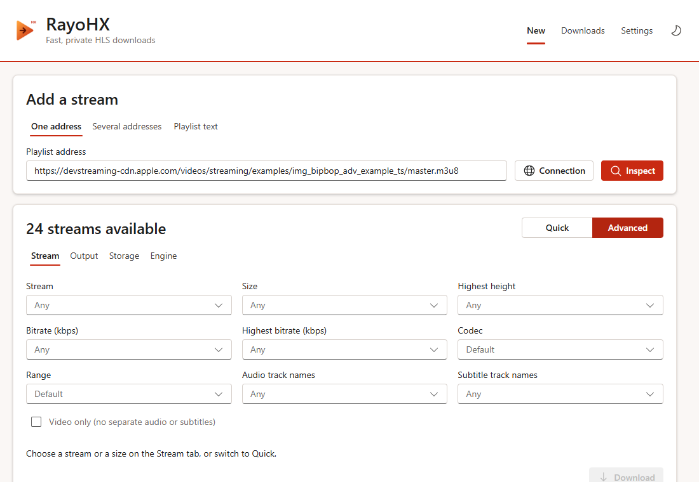
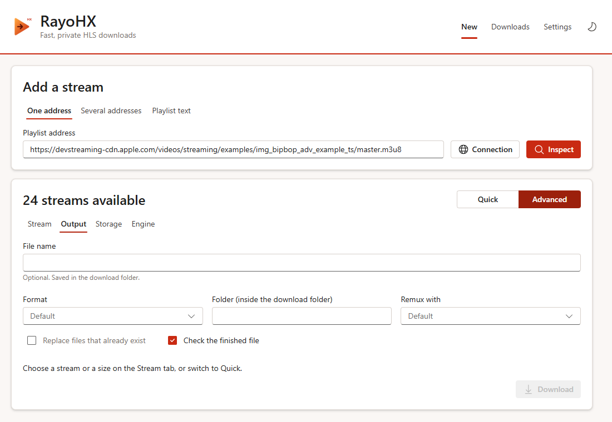
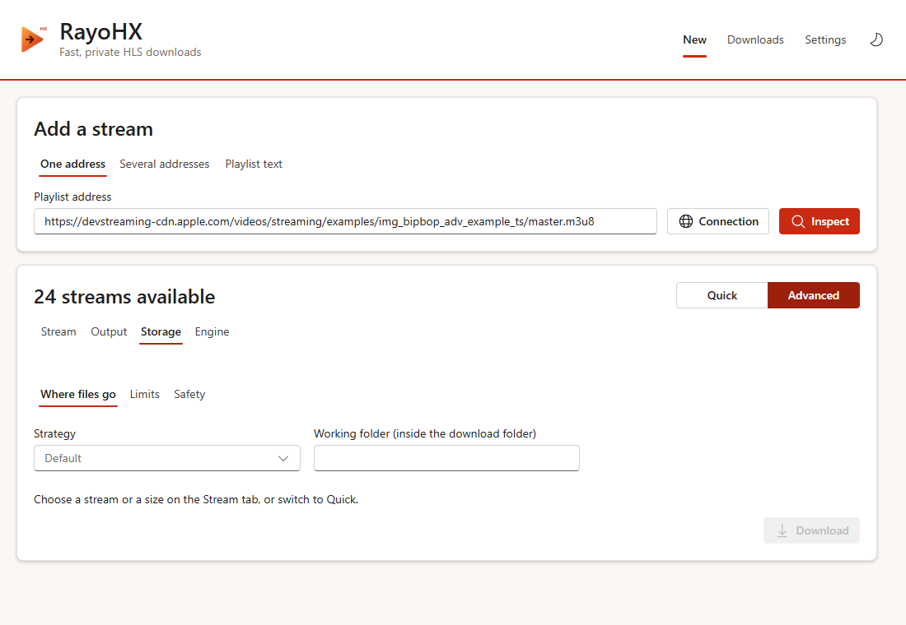
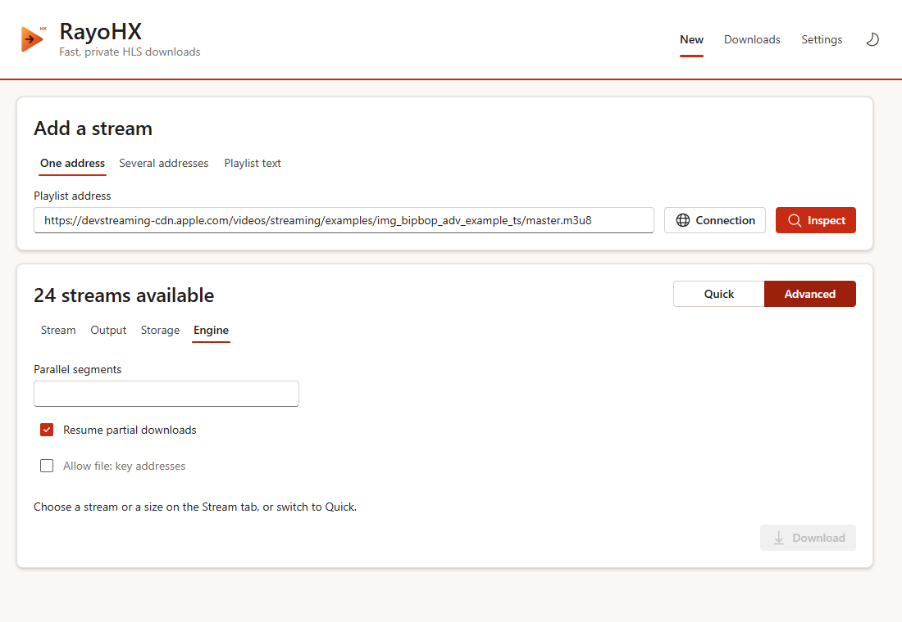

# Add a stream

The **New** page is where a download starts. Choose how to give RayoHX the stream, look at what it offers,
then pick a quality or the exact stream and press **Download**. Back to the [window guide](../ui.md).

## Give it the stream

Three tabs say how you add it.

### One address

Paste the address of an `.m3u8` playlist into **Playlist address** and press **Inspect**. RayoHX reads the
playlist and tells you how many streams it offers.

### Several addresses

Put one address on each line. Lines that start with `#` are ignored. Pick a quality, then press
**Download all** to start every one of them at once.

### Playlist text

If you already have the contents of an `.m3u8` file, paste them into **Playlist text**. Give a **Base
address** so that any relative links in the playlist can be turned into full addresses, then press
**Inspect**.

## Connection options

The **Connection** button next to the address opens the options that decide how RayoHX asks for the stream.
They are grouped in tabs:

- **Request** has headers, cookies, the user agent, the referer and origin, and a cookies file.
- **Proxy**, **Connection** and **Security** cover the proxy, retries and speed limit, and certificates.

Fields you leave empty use your [default options](settings.md#default-options). A cookies file or
certificate on this computer is picked with **Browse**.

## Quick or Advanced

After **Inspect**, choose how to pick what to download. Only the open choice is used.

### Quick

Pick a **Quality** and press **Download**. `best` is the default unless you saved another quality in the
settings.

### Advanced

Pick the exact stream, or narrow the choice, and set what happens to the files. The tabs are:

| Tab | What you set |
|---|---|
| **Stream** | A stream by number, size, highest height, bitrate, codec and range, and the audio and subtitle tracks the stream has. **Video only** leaves out audio and subtitles. |
| **Output** | The file name, format, a folder inside the download folder, what to remux with, whether to replace files that already exist, and whether to check the finished file. |
| **Storage** | Where files go (strategy and working folder), limits and safety. |
| **Engine** | How many segments download in parallel, whether partial downloads resume, and whether `file:` key addresses are allowed. |

**Download** stays off until you choose a stream or a size on the **Stream** tab, or switch to Quick. Picking
a stream turns off the filters that no longer apply, because a stream already decides them.

Audio and subtitle choices appear only when the stream has them. Fields that point at files on this
computer appear only when local files are allowed.

## After you press Download

The download appears on the [Downloads](downloads.md) page, and the form is cleared so you can add the
next one.
