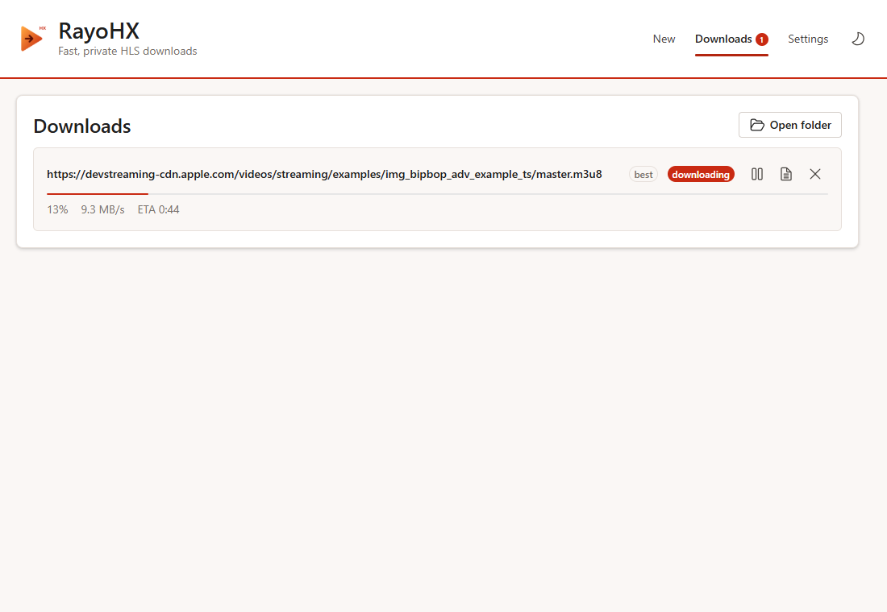
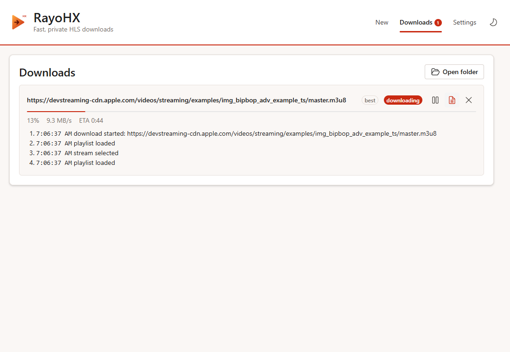
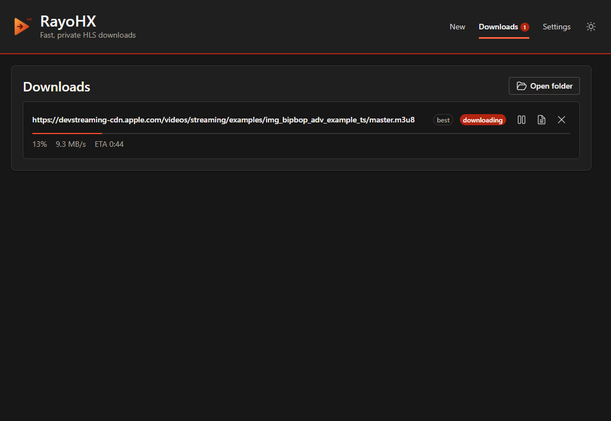

# Downloads

The **Downloads** page lists every download, newest activity live, and keeps the list between restarts.
A number next to the page name counts the downloads that are still running. Back to the
[window guide](../ui.md).

## Each download

Every download shows:

- the address, or the saved file name
- the quality it was started with, and its state (such as **downloading** or **completed**)
- a progress bar with the percentage, speed and time left while it runs

The buttons on a download change with its state. You can pause and resume a running download, stop it, and
remove it from the list. A download that failed offers **Retry**. If it failed because the file already
exists, an **Overwrite** button replaces that file and starts again.

A download that was cut short by closing the app shows as failed the next time you open it, and **Retry**
starts it again.

## What the engine reported

The page icon on a download opens its log: a numbered list of what the engine reported, each line with the
time. The log holds the last 200 events and is kept between restarts. A download without a log has no such
button.

## Open folder

**Open folder** shows the download folder in Explorer. It can only open the folder downloads are saved in. To
change that folder, see [Settings](settings.md).

## Clear finished downloads

Use **Clear history** to remove the downloads that are finished from the list. Running downloads stay.
Files that were saved are not deleted.

## Dark theme

