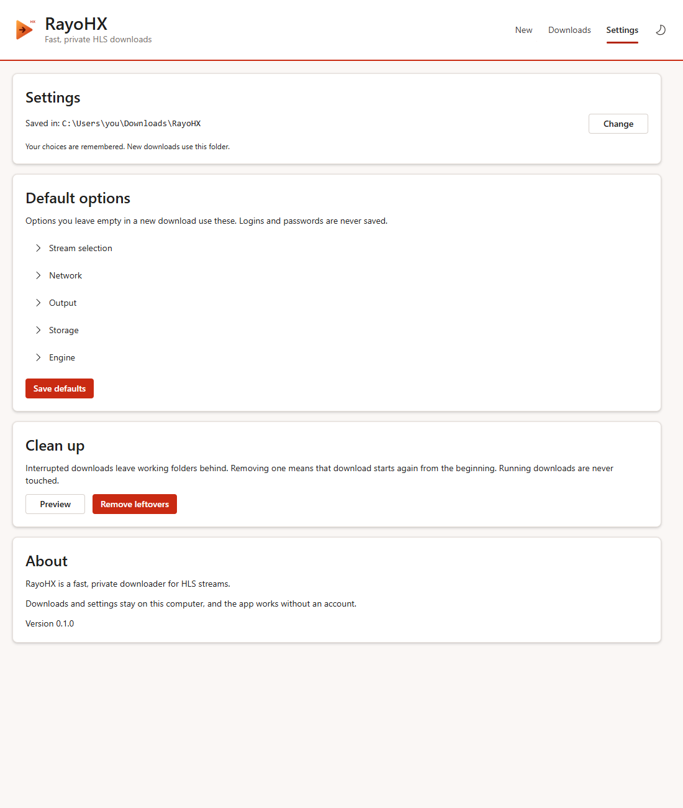
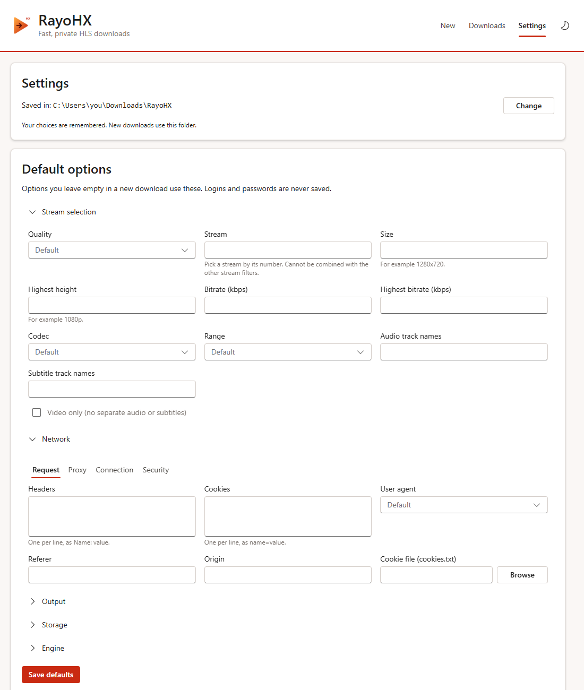
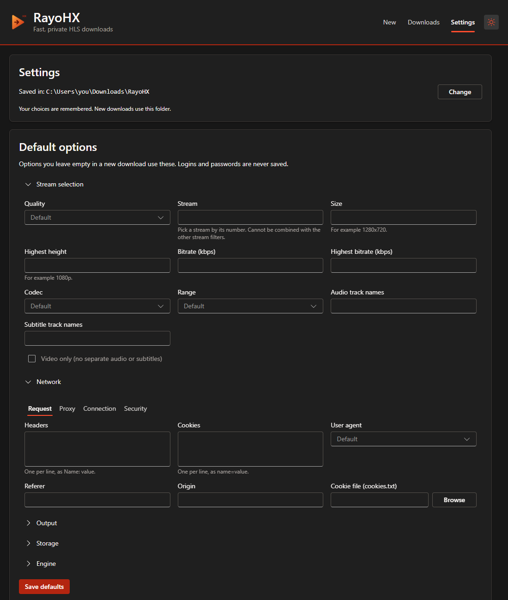

# Settings

The **Settings** page holds what applies to every download: where files are saved, the default options,
clean-up and the version. Your choices are remembered between restarts. Back to the
[window guide](../ui.md).

## Download folder

**Saved in** shows the folder new downloads are written to. **Change** opens the system folder picker.
New downloads use the new folder; downloads already saved stay where they are. The folder can be changed
only when local files are allowed.

## Default options

**Default options** holds every download option, in the same groups as the Advanced choice: **Stream
selection**, **Network**, **Output**, **Storage** and **Engine**. Open a group to see its fields.

Press **Save defaults** to keep them. From then on:

- a new download shows them as the value of any field you leave empty
- anything you set on the form for one download wins over the default
- a **Quality** saved here is the quality Quick starts with

**Logins and passwords are never saved.** Type them with the download that needs them.

## Clean up

A download cut short leaves a working folder behind. **Preview** lists what would be removed, and **Remove
leftovers** deletes it. Removing one means that download starts again from the beginning. Running downloads
are never touched.

## About

Shows what RayoHX is and its version.

## Theme

The sun and moon button in the top bar switches between the light and dark themes, and the choice is
remembered.

